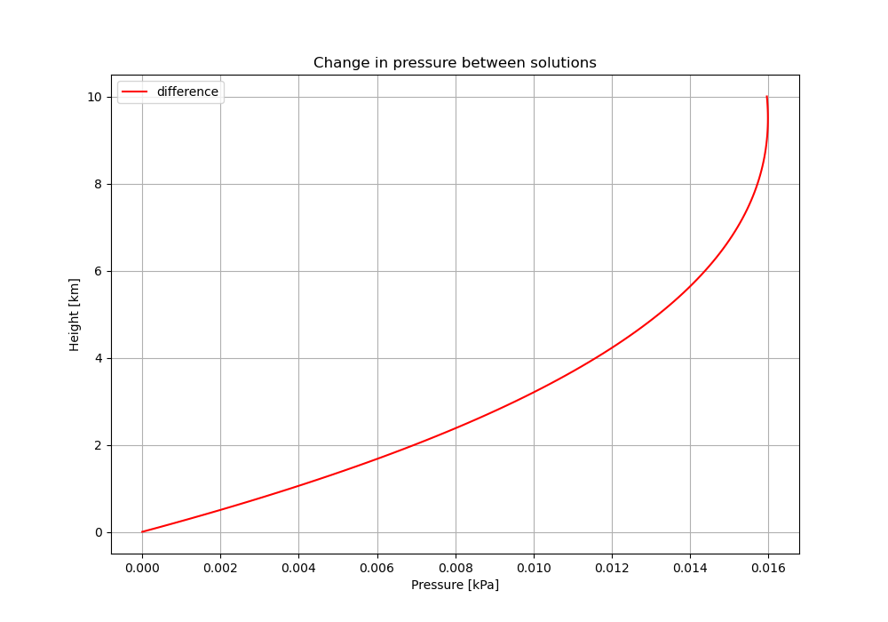
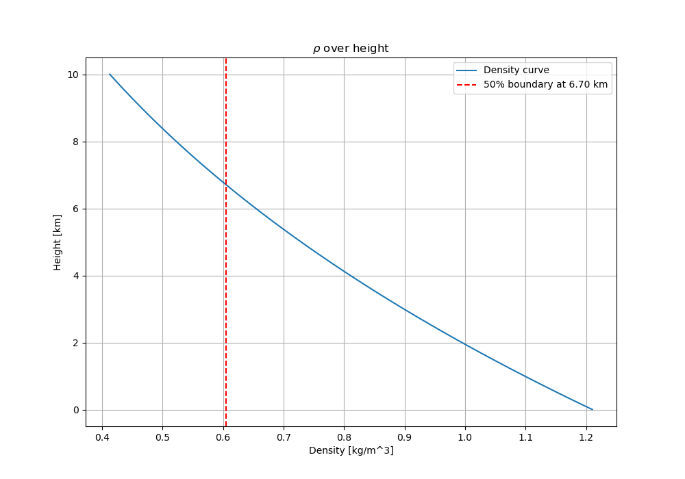
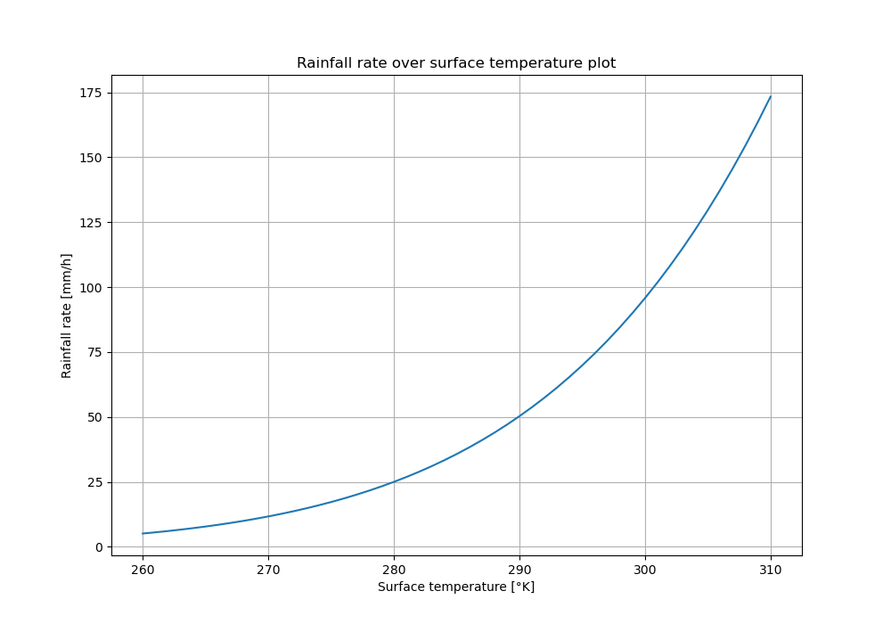
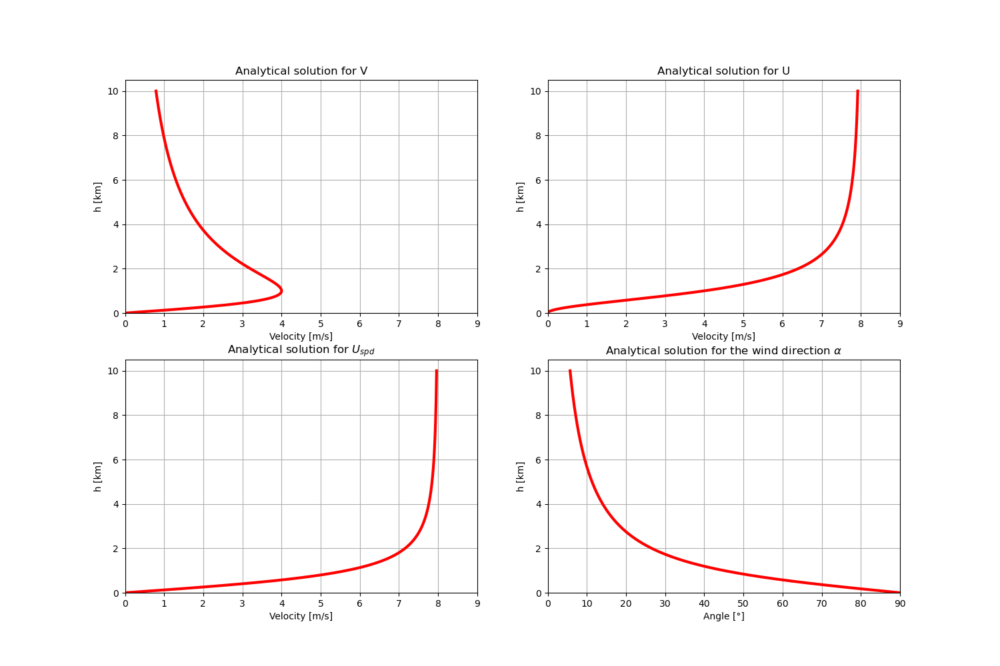

# Dynamics of Solids and Fluids Part 2

**By: Maxx Vercouteren & Mark Geeraerts**

## Table of contents

1. [Week 1](#Week1)
2. [Week 2](#Week2)

3. [Week 3](#paragraph2)

## Week 2.1: Water in the Atmosphere: How much? 

Here we will analyse numerically the vertical profile of the water vapor specific humidity in the
lower 10 km of an idealized atmospheric column that is in hydrostatic equilibrium. Consider a
situation in which the temperature T of the air column is given by
$$T (z) = Tsfc + γz (1)$$
with Tsfc the surface temperature, z the height above the ground surface and $\gamma$ = −6 K/km the
vertical gradient of the temperature. The surface pressure $p_{sfc}$ = 1.018 · 105 Pa.
Let us divide the atmosphere into vertical layers with an equidistant thickness $\Delta z$. We will
denote properties at level k by a subscript ’$k$`. We will approximate the temperature in a layer
between $z_k$ and $z_{k+1}$ as $T_{k+1/2} = (T_{k+1} + T_k)/2$, which allows to compute numerically the pressure $p_{k+1}$ from $p_k$. Note that this approximation becomes less and less accurate if you take a
large value for $\Delta z$, so take care that you take the vertical grid size sufficiently small.

### Question 1a

**(10 points) Compute and plot the pressure as a function of height for an atmosphere with-
out moisture and surface temperature $T_{sfc}$ = 293 K. Check your numerical results by comparing
them with the analytical solution.**

We calculate the pressure as a function of height and obtain two results: a numerical and analytical solution.

*Numerical solution*

For the numerical solution, we first calculate the the temperature gradient over height using the surface temperature $T_{sfc}$ and the vertical gradient $\gamma$ with steps of $\Delta z$ in the following formula:

$$T_k = T_{sfc} + \gamma \cdot k \Delta z [1.1]$$

With equation 1.1, we can now start calculating the pressure gradient, which we can do using the following equation:

$$p_{k+1} = p_k \cdot e^{-\frac{g\Delta z}{R_dT_{k+1/2}}} [1.2]$$

Where at $p_0$ we have the surface pressure. With the actual calculations, we use a $\Delta z$ of 100 meters, where our domain ranges from 0 to 10 km height.
 
*Analytical solution*

For the analytical solution, we use the following equation from the slides:

$$p_z = p_{sfc}\left( \frac{T_{sfc}+\gamma z}{T_{sfc}} \right)^{-\frac{g}{R_d\gamma}}[1.3]$$

*Results*

With both pressure gradients calculated, we plot them in the same graph, as can be seen in the figure below. From this we can see that the solutions look identical to each other, as they perfectly overly each other.

This difference is also calculated, as can be seen in the plot below. From here, we see that the difference between the solutions increases with height until it reaches a height of roughly 9 km, where it then slowly reduces the difference.

### Question 1b

**(4 points) Use the results from 1a to compute and plot the vertical profile of the air density.
At which height is the air density 50% of the surface value?**

With the numerical pressure gradient from the previous question, we can now calculate a vertical profile of the air density using the following equation:

$$\rho_z = \frac{p_z}{R_dT_z}[1.4]$$

From this, we obtain the figure from below. With this vertical profile, we can calculate at which height the air density is at 50% of the surface value, which is 50% of 1.21 km/m^3. This results at a height of 6.70 kilometers, as can be seen in the plot.

### Question 1c (CHECK UNITS)

**(10 points) Consider an atmosphere with constant relative humidity RH = 0.8. Use the
information from the lecture slides to compute and plot the vertical profiles of the water vapor
specific humidity $q_v$ for $T_{sfc}$ = 271 and 303 K, respectively. Write down the numerical values of
your solutions for a height of 5 km.**

We want to calculate the vertical profiles of $q_v$ for two different surface temperatures. To calculate that, we first want to calculate $e_{sat}$, which we can do using the following emperical equation:

$$e_{sat,z} = 610.78 e^{\frac{17.2694(T_z - 273.16)}{T_z - 35.86}}[1.5]$$

where

$$T_z = T_{sfc} + \gamma z[1.6]$$

With this equation, we can calculate the vapor pressure over height:

$$e_{v,z} = RH \cdot e_{sat,z}[1.7]$$

Finally, we can calculate the water vapor specific humidity using the following two equations:

$$r_{v,z} = \frac{e_vR_d}{p_zR_v}[1.8]$$

$$q_{v,z} = \frac{r_{v,z}}{1+r_{v,z}} [1.9]$$

These equations are implemented into python and using the two different surface temperatures we calculate and plot the two vertical profiles in the plot below. At a height of 5 kilometers, $q_v$ is equal to 3.684E-04 and 5.430E-03 for surface temperatures of 271 and 303 °K, respectively.

### Question 1d

**(10 points) Calculate the Water Vapor Path, $WVP= \int^{z_t}_0 ρq_vdz$, with $z_t$ = 10 km, as a function of the surface temperature 260 ≤ $T_{sfc}$ ≤ 310 K. What are the minimum and maximum values for the WVP? Determine the rate at which WVP increases per degree of temperature change, for example by plotting $dWVP/dT_{sfc}$**

We want to calculate the Water Vapor Path by taking the integral of $\rho q_v$. However, both $\rho$ and $q_v$ depend on $z$, and and both quite complex. Therefore, we use numerical integration, specifically the trapezoidal rule, to calculate the WVP. With the boundaries defined and our formulas for  $\rho$ and $q_v$ ready from previous questions, we calculate the WVP for a range of different surface temperatures, and plot themin the figure below.

From these results, the gradient is also calculated, as can be seen in the plot next to the normal WVP. From this we can see that as the surface temperature increases, so does our WVP. But we can also see from the gradient plot that the rate at which the WVP increase per degree also increases with temperature. Therefore, both plots look similar in shape.

Finally, we obtain the minimum and maximum values for the WVP, which are 2.85 and 96.30 respectively.

### Question 1e

**(5 points) Suppose that the vertical velocity W in an atmospheric column is 5 m/s (upwards).
As a results, the air will cool, water vapor will condense and will ultimately precipitate to reach
the ground surface. Assume that the air in the column rises until the top of the troposphere at
a height H of 10 km. Plot the rainfall rate P in mm/h as a function of the surface temperature
Tsfc, by assuming that all the water vapor that is present in the atmospheric column is converted
into rain during a time period T = H/W . Are the numbers that you find realistic?**

We convert the vertical velocity to meters per hour and calculate the rainfall rate using the simple equation below:

$$P = WVP \cdot W[1.10]$$

From this equation, we can calculate the rainfall rate for different surface temperatures using the previous values for the WVP, and plot the results in the figure below.

Looking at the values from the plot, we think that the extreme values are very questionable. At -13 °C, there is still some precipitation, and 175 mm/hr at 37°C seems like an awefull lot of precipitation in a single hour.
However, the other values seem pretty reasonable.

## Week 2.2: Wind: Effects of surface friction and boundary-layer depth 

### 2a.

**(5 points) Consider a flow that is in a geostrophic balance. Show from the the conservation of mass equation, which reads,**
$$\frac{\partial U}{\partial x} + \frac{\partial V}{\partial y} + \frac{\partial W}{\partial z} = 0$$
**with the mean vertical velocity indicated by W , that a pure geostrophic flow does not support
any mean vertical motion. Ignore latitudinal variations in f .**

<!-- ## Answer

When at a geostrophic state, we get:

* $U_g = -\frac{1}{\rho f} \frac{\partial P}{\partial y}$,
* $V_g = \frac{1}{\rho f} \frac{\partial P}{\partial x}$,

which we can plug into the conservation of mass equation and rewrite it for $\frac{\partial W}{\partial z}:$

$\frac{\partial W}{\partial z} = - (\frac{\partial U_g}{\partial x} + \frac{\partial V_g}{\partial y})$

$\frac{\partial W}{\partial z} = -\frac{1}{\rho f} ( -\frac{\partial^2 P}{\partial y \partial x} + \frac{\partial^2 P}{\partial x \partial y})$

And we know that $\frac{\partial^2 P}{\partial y \partial x} = \frac{\partial^2 P}{\partial x \partial y}$, so:

$\frac{\partial W}{\partial z} = -\frac{1}{\rho f} \cdot 0 = 0$ -->

When at a geostrophic state, we get:

* $U_g = -\frac{1}{\rho f} \frac{\partial P}{\partial y}$,
* $V_g = \frac{1}{\rho f} \frac{\partial P}{\partial x}$,

which we can plug into the conservation of mass equation and rewrite it for $\frac{\partial W}{\partial z}:$

$$\frac{\partial W}{\partial z} = - (\frac{\partial U_g}{\partial x} + \frac{\partial V_g}{\partial y}) [1]$$

$$\frac{\partial W}{\partial z} = -\frac{1}{\rho f} ( -\frac{\partial^2 P}{\partial y \partial x} + \frac{\partial^2 P}{\partial x \partial y}) [2]$$

We take the integral of $dz$ to get a formula for $W$:

$$W = -\int_0^z \frac{1}{\rho f} ( -\frac{\partial^2 P}{\partial y \partial x} + \frac{\partial^2 P}{\partial x \partial y}) dz  [3]$$

$$W = - \frac{1}{\rho f} ( -\frac{\partial^2 P}{\partial y \partial x} + \frac{\partial^2 P}{\partial x \partial y}) \cdot z [4]$$

(We can do this, since $f$ and $\rho$ are constant and do not depend on $z$)

And we know that $\frac{\partial^2 P}{\partial y \partial x} = \frac{\partial^2 P}{\partial x \partial y}$, so:

$$W = -\frac{1}{\rho f} \cdot 0 \cdot z = 0 [5]$$

Since $W = 0 [m/s]$, we see that there is no vertical mean velocity in this scenario.

### 2b.

**(5 points) Derive that surface friction causes a mean vertical motion at the top of the turbulent layer h according to:**
$$W|_h = \frac{1}{f} \left( \frac{\partial \overline{u'w'}_{sfc}}{\partial y}-\frac{\partial \overline{u'w'}_{sfc}}{\partial x}   \right)$$

As there is no change in velocity over time, we can say that:

$$
0 = fV - fV_g - \frac{\partial \overline{u'w'}}{\partial z} [1.1]$$
$$f(V - V_g) = \frac{\partial \overline{u'w'}}{\partial z} [1.2] $$

and

$$
0 = -fU - (-fU_g) - \frac{\partial \overline{v'w'}}{\partial z} [2.1]$$
$$ -f(U - U_g) = \frac{\partial \overline{v'w'}}{\partial z} [2.2] $$

We then integrate over [1.2]:
$$
\int_0^h f(V - V_g) dz = \int_0^h \frac{\partial \overline{u'w'}}{\partial z} dz [3.1]
$$

$$
f \left( \int_0^h V dz - h V_g \right) = \overline{u'w'}_h - \overline{u'w'}_{sfc} = -\overline{u'w'}_{sfc} [3.2]
$$

$$\int_0^h V dz = h V_g - \frac{1}{f} \overline{u'w'}_{sfc} [3.3]
$$

We then integrate over [2.2]:
$$
\int_0^h -f(U - U_g) dz = \int_0^h \frac{\partial \overline{v'w'}}{\partial z} dz [4.1]
$$
$$
-f \left( \int_0^h U dz - h U_g \right) = \overline{v'w'}_h - \overline{v'w'}_{sfc} = -\overline{v'w'}_{sfc} [4.2]
$$
$$
\int_0^h U dz = h U_g + \frac{1}{f} \overline{v'w'}_{sfc} [4.3]
$$

We then integrate the equation from question 2a:
$$
\int_0^h \left( \frac{\partial U}{\partial x} + \frac{\partial V}{\partial y} + \frac{\partial W}{\partial z} \right) dz = 0 [5.1]
$$

$$
\frac{\partial}{\partial x} \left( \int_0^h U dz \right) + \frac{\partial}{\partial y} \left( \int_0^h V dz \right) + (W_h - W_0) = 0 [5.2]
$$

At the ground surface, there is no vertical velocity, so at z=0 we get $W_0=0$, which we then implement into equation 5.2:

$$
W_h = - \left[ \frac{\partial}{\partial x} \left( \int_0^h U dz \right) + \frac{\partial}{\partial y} \left( \int_0^h V dz \right) \right] [6]
$$

We then substitute equation 3.3 and 4.3 into equation 6:

$$
W_h = - \left[ \frac{\partial}{\partial x} \left( h U_g + \frac{1}{f} \overline{v'w'}_{sfc} \right) + \frac{\partial}{\partial y} \left( h V_g - \frac{1}{f} \overline{u'w'}_{sfc} \right) \right] [7.1]
$$

$$
= - \left[ h \left( \frac{\partial U_g}{\partial x} + \frac{\partial V_g}{\partial y} \right) + \frac{1}{f} \frac{\partial \overline{v'w'}_{sfc}}{\partial x} - \frac{1}{f} \frac{\partial \overline{u'w'}_{sfc}}{\partial y} \right] [7.2]
$$

Since we saw $\frac{\partial U_g}{\partial x} + \frac{\partial V_g}{\partial y} = 0$ in the previous question, we can still apply that to quation 7.2, which can be seen in equation 8.

$$
W_h = - \left( \frac{1}{f} \frac{\partial \overline{v'w'}_{sfc}}{\partial x} - \frac{1}{f} \frac{\partial \overline{u'w'}_{sfc}}{\partial y} \right) = \frac{1}{f} \left( \frac{\partial \overline{u'w'}_{sfc}}{\partial y} - \frac{\partial \overline{v'w'}_{sfc}}{\partial x} \right) [8]
$$

Finally, we can see that equation 8 is the same as the equation in the question. Therefore we know that our derivation is correct.

### 2c.

**(5 points) Find from the literature a typical order of magnitude for the bulk drag coefficient Cd over the Earth’s ocean. Briefly summarize how this value was obtained.**

Retrieved from [this website from the KNMI](https://cdn.knmi.nl/knmi/pdf/bibliotheek/knmipubTR/TR361.pdf), we can see that they found a wide range of values,since it changes with wind speed, they all agreed that at roughly 30 m/s the bulk drag coefficient $C_D$ reaches it's peak at roughly $2.75 \cdot 10^{−3}$. They obtained this value based on wind speed measurements taken at a height of 10 meters above sea level. (NOT FINISHED)

Research from [this paper](https://www.tandfonline.com/doi/full/10.1080/16000870.2018.1463805#d1e1052) also shows at windspeeds of roughly 30 m/s that we have a $C_D$ of roughly $2.115 \cdot 10^{−3}$.

In conclusion, we are looking at an order of magnitude of $ 10^{-3}$.

(NOT FINISHED I THINK)

### 2d.

**(10 points) Derive analytical steady-state solutions for U and V . For compact solutions you may want to choose $U_g > 0$ and $V_g = 0$.**

We start with the x and y components of the steady state momentum equation:
$$ \text{x component:} 0 = -\frac{1}{\rho}\frac{\partial p}{\partial x}+fv-\frac{k_{sfc}u}{h} [1.a]$$
$$ \text{y component:} 0 = -\frac{1}{\rho}\frac{\partial p}{\partial y}-fu-\frac{k_{sfc}v}{h} [1.b]$$

It is given that:
$$ V_g = \frac{1}{\rho f} \frac{\partial p}{\partial x} = 0 [2.a]$$
$$ U_g = - \frac{1}{\rho f} \frac{\partial p}{\partial y} > 0 [2.b]$$

We can now substitute [2.a] and [2.b] into [1.a] and [1.b]:

$$ 0 = fv-\frac{k_{sfc}u}{h} [3.a]$$
$$ 0= f U_g-fu-\frac{k_{sfc}v}{h} [3.b]$$

We now rewrite [3.a] such that we get a solution for $v$:

$$ v =\frac{k_{sfc} u}{hf} [4] $$

We now rewrite [3.b] such that we get a solution for $u$:

$$ f(u-U_g)= -\frac{k_{sfc}v}{h} [5.a]$$
(substitute [4] into [5.a])
$$ f(u-U_g)= -\frac{k_{sfc}^2u}{h^2f} [5.b]$$
$$ u = -\frac{k_{sfc}^2u}{h^2f^2} +U_g [5.c]$$
$$ u(1+\frac{k_{sfc}^2}{h^2f^2}) = U_g [5.d]$$
$$ u = \frac{U_g}{(1+\frac{k_{sfc}^2}{h^2f^2})} [5.e]$$

We can now substitute [5.e] into [4] to get a true solution for $v$:

$$ v =\frac{k_{sfc} U_g}{hf(1+\frac{k_{sfc}^2}{h^2f^2})} [6.a]$$
$$ v =\frac{k_{sfc} U_g}{hf+\frac{k_{sfc}^2}{hf}} [6.b]$$

With this, we now a have steady state solutions for $u$ [5.e] and $v$ [6.b].

### 2e. (NOT FINISHED)

**(10 points) Make plots of U , V , $U_{spd}$ and the wind angle $\tan(\alpha) = V /U$ as a function of the boundary layer depth h. Add to each plot solutions for $k_{sfc} = 0.1$, which could represent an enhanced value for the bulk surface friction effect over the continents. Explain and discuss the dependency of your solutions (the ones for U , V , $U_{spd}$ and α) on $k_{sfc}$, and the boundary layer depth h.**

Using equation 5.e and 6.b from the previous question, we obtain our values for V and U using a typical value for $U_g$, which is 8 m/s. We can then use the following equation to calculate $U_{spd}$:

$$
V_{spd} = \sqrt{U^2+V^2}
$$

With this equation, we calculate $U_{spd}$. Finally, we can also now calculate the wind angle by using this equation:

$$
\alpha = \arctan{(V/U)}
$$

With these calculations, we obtain the plots in the figure below.

