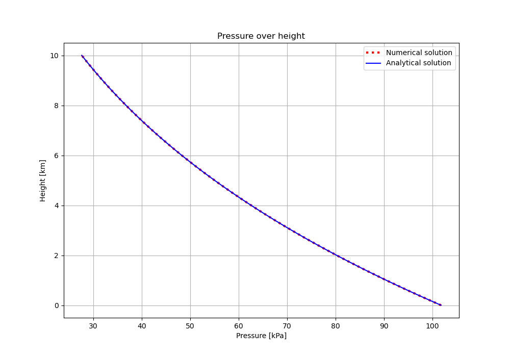
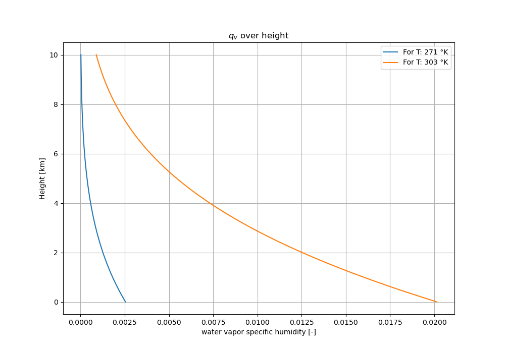
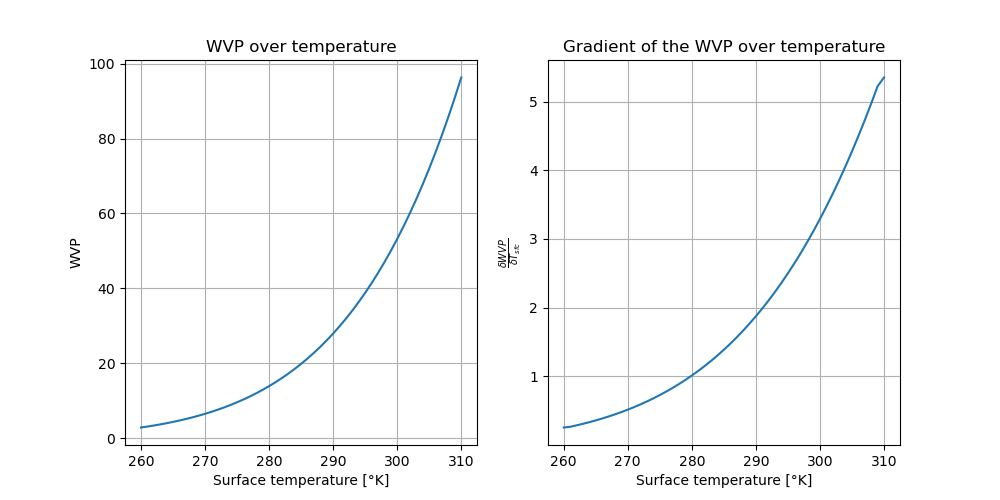
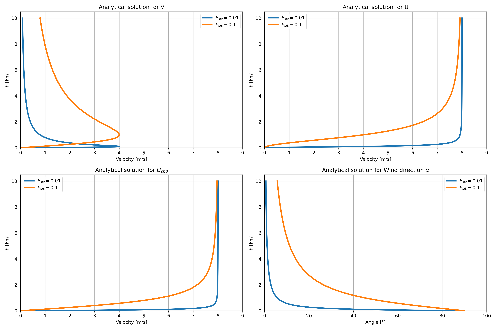
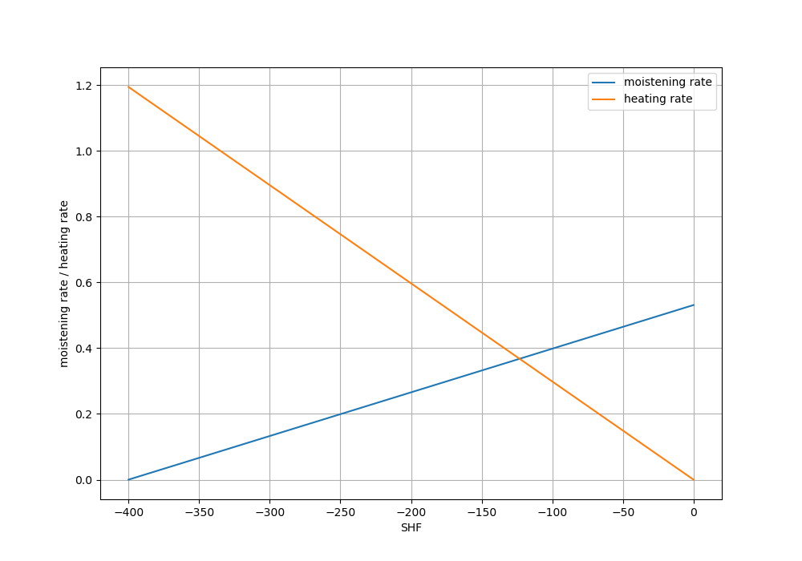
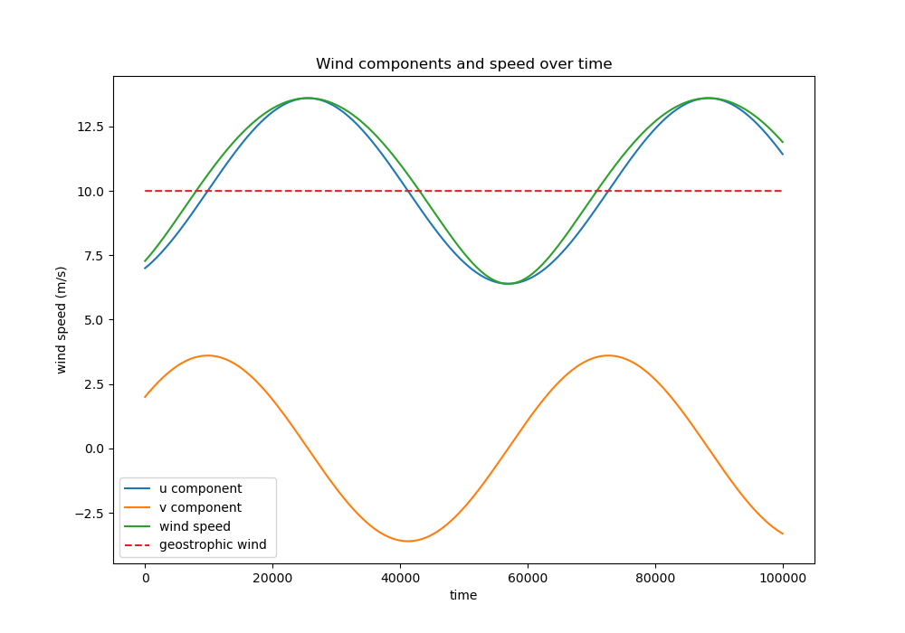
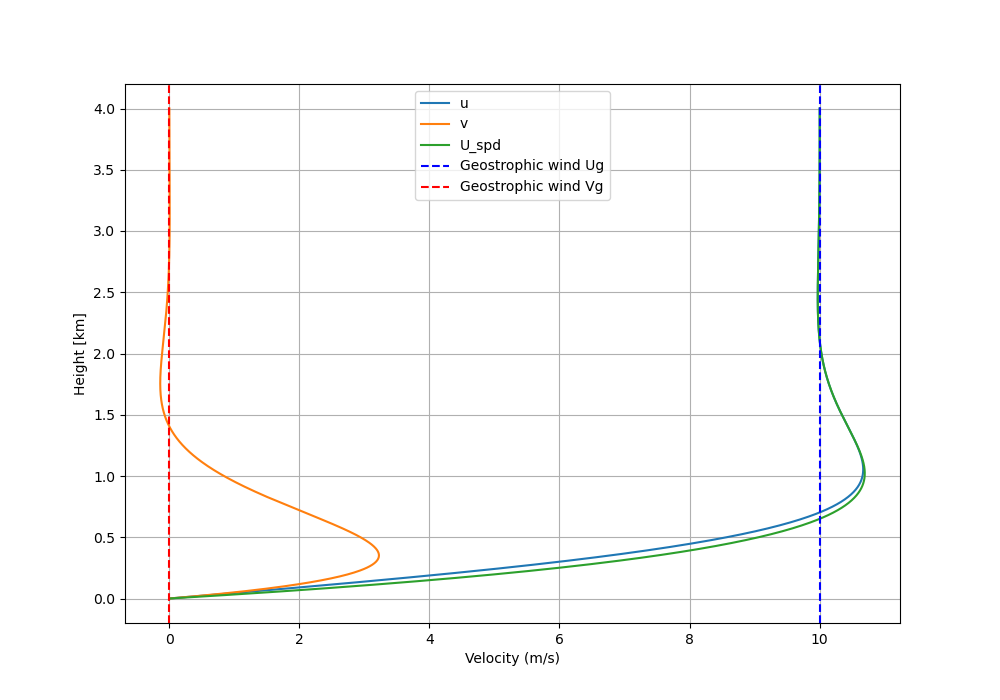
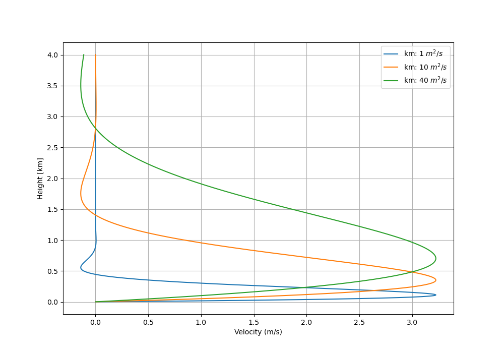
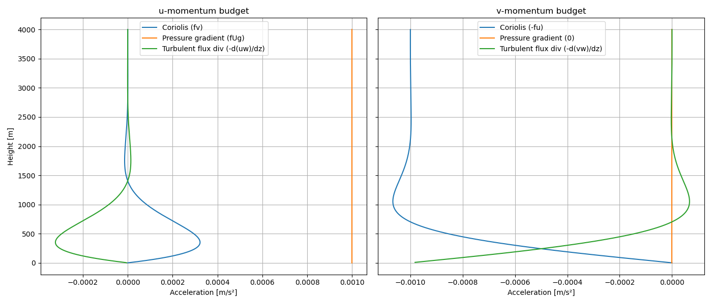

# Dynamics of Solids and Fluids Part 2

**By: Maxx Vercouteren & Mark Geeraerts**

## Table of contents

1. [Week 1](#Week1)
2. [Week 2](#Week2)

3. [Week 3](#paragraph2)

## Week 2.1: Water in the Atmosphere: How much? 

Here we will analyse numerically the vertical profile of the water vapor specific humidity in the
lower 10 km of an idealized atmospheric column that is in hydrostatic equilibrium. Consider a
situation in which the temperature T of the air column is given by
$$T (z) = Tsfc + γz (1)$$
with Tsfc the surface temperature, z the height above the ground surface and $\gamma$ = −6 K/km the
vertical gradient of the temperature. The surface pressure $p_{sfc}$ = 1.018 · 105 Pa.
Let us divide the atmosphere into vertical layers with an equidistant thickness $\Delta z$. We will
denote properties at level k by a subscript ’$k$`. We will approximate the temperature in a layer
between $z_k$ and $z_{k+1}$ as $T_{k+1/2} = (T_{k+1} + T_k)/2$, which allows to compute numerically the pressure $p_{k+1}$ from $p_k$. Note that this approximation becomes less and less accurate if you take a
large value for $\Delta z$, so take care that you take the vertical grid size sufficiently small.

### Question 1a

**(10 points) Compute and plot the pressure as a function of height for an atmosphere with-
out moisture and surface temperature $T_{sfc}$ = 293 K. Check your numerical results by comparing
them with the analytical solution.**

We calculate the pressure as a function of height and obtain two results: a numerical and analytical solution.

*Numerical solution*

For the numerical solution, we first calculate the the temperature gradient over height using the surface temperature $T_{sfc}$ and the vertical gradient $\gamma$ with steps of $\Delta z$ in the following formula:

$$T_k = T_{sfc} + \gamma \cdot k \Delta z [1.1]$$

With equation 1.1, we can now start calculating the pressure gradient, which we can do using the following equation:

$$p_{k+1} = p_k \cdot e^{-\frac{g\Delta z}{R_dT_{k+1/2}}} [1.2]$$

Where at $p_0$ we have the surface pressure. With the actual calculations, we use a $\Delta z$ of 100 meters, where our domain ranges from 0 to 10 km heigh.
 
*Analytical solution*

For the analytical solution, we use the following equation:

$$p_z = p_{sfc}\left( \frac{T_{sfc}+\gamma z}{T_{sfc}} \right)^{-\frac{g}{R_d\gamma}}[1.3]$$

*Results*

With both pressure gradients calculated, we plot them in the same graph, as can be seen in the figure below. From this we can see that the solutions look identical to each other, as they perfectly overly each other.

This difference is also calculated, as can be seen in the plot below. From here, we see that the difference between the solutions increases with height until it reaches a height of roughly 9 km, where it then slowly reduces the difference.

### Question 1b

**(4 points) Use the results from 1a to compute and plot the vertical profile of the air density.
At which height is the air density 50% of the surface value?**

With the numerical pressure gradient from the previous question, we can now calculate a vertical profile of the air density using the following equation:

$$\rho_z = \frac{p_z}{R_dT_z}[1.4]$$

From this, we obtain the figure below. With this vertical profile, we can calculate at which height the air density is at 50% of the surface value, which is 50% of 1.21 kg/m^3. This results at a height of 6.70 kilometers, as can be seen in the plot.

### Question 1c 

**(10 points) Consider an atmosphere with constant relative humidity RH = 0.8. Use the
information from the lecture slides to compute and plot the vertical profiles of the water vapor
specific humidity $q_v$ for $T_{sfc}$ = 271 and 303 K, respectively. Write down the numerical values of
your solutions for a height of 5 km.**

We want to calculate the vertical profiles of $q_v$ for two different surface temperatures. To calculate that, we first want to calculate $e_{sat}$, which we can do using the following emperical equation:

$$e_{sat,z} = 610.78 e^{\frac{17.2694(T_z - 273.16)}{T_z - 35.86}}[1.5]$$

where

$$T_z = T_{sfc} + \gamma z[1.6]$$

With this equation, we can calculate the vapor pressure over height:

$$e_{v,z} = RH \cdot e_{sat,z}[1.7]$$

Finally, we can calculate the water vapor specific humidity using the following two equations:

$$r_{v,z} = \frac{e_vR_d}{p_zR_v}[1.8]$$

$$q_{v,z} = \frac{r_{v,z}}{1+r_{v,z}} [1.9]$$

These equations are implemented into python and using the two different surface temperatures we calculate and plot the two vertical profiles in the plot below. At a height of 5 kilometers, $q_v$ is equal to 3.684E-04 and 5.430E-03 for surface temperatures of 271 and 303 °K, respectively.

### Question 1d

**(10 points) Calculate the Water Vapor Path, $WVP= \int^{z_t}_0 ρq_vdz$, with $z_t$ = 10 km, as a function of the surface temperature 260 ≤ $T_{sfc}$ ≤ 310 K. What are the minimum and maximum values for the WVP? Determine the rate at which WVP increases per degree of temperature change, for example by plotting $dWVP/dT_{sfc}$**

We want to calculate the Water Vapor Path by taking the integral of $\rho q_v$. However, both $\rho$ and $q_v$ depend on $z$, and and both quite complex. Therefore, we use numerical integration, specifically the trapezoidal rule, to calculate the WVP. With the boundaries defined and our formulas for  $\rho$ and $q_v$ ready from previous questions, we calculate the WVP for a range of different surface temperatures, and plot themin the figure below.

From these results, the gradient is also calculated, as can be seen in the plot next to the normal WVP. From this we can see that as the surface temperature increases, so does our WVP. But we can also see from the gradient plot that the rate at which the WVP increase per degree also increases with temperature. Therefore, both plots look similar in shape.

Finally, we obtain the minimum and maximum values for the WVP, which are 2.85 kg/m^2 and 96.30 kg/m^2 respectively.

### Question 1e

**(5 points) Suppose that the vertical velocity W in an atmospheric column is 5 m/s (upwards).
As a results, the air will cool, water vapor will condense and will ultimately precipitate to reach
the ground surface. Assume that the air in the column rises until the top of the troposphere at
a height H of 10 km. Plot the rainfall rate P in mm/h as a function of the surface temperature
Tsfc, by assuming that all the water vapor that is present in the atmospheric column is converted
into rain during a time period T = H/W . Are the numbers that you find realistic?**

We convert the vertical velocity to meters per hour and calculate the rainfall rate using the simple equation below:

$$P = WVP \cdot W[1.10]$$

From this equation, we can calculate the rainfall rate for different surface temperatures using the previous values for the WVP, and plot the results in the figure below.

Looking at the values from the plot, we think that the values obtained are reasonable. Looking at the extreme values for instance, at -13 °C, there is very limited precipitation. Rainrates of 175 mm/hr at 37°C seems like a lot, and may be a bit higher than one might expect, but the order of magnitude is not extremely unreasonable. For short periods of time in the tropics it is not unthinkable that this may for instance occur.

## Week 2.2: Wind: Effects of surface friction and boundary-layer depth 

### 2a.

**(5 points) Consider a flow that is in a geostrophic balance. Show from the the conservation of mass equation, which reads,**
$$\frac{\partial U}{\partial x} + \frac{\partial V}{\partial y} + \frac{\partial W}{\partial z} = 0$$
**with the mean vertical velocity indicated by W , that a pure geostrophic flow does not support
any mean vertical motion. Ignore latitudinal variations in f .**

<!-- ## Answer

When at a geostrophic state, we get:

* $U_g = -\frac{1}{\rho f} \frac{\partial P}{\partial y}$,
* $V_g = \frac{1}{\rho f} \frac{\partial P}{\partial x}$,

which we can plug into the conservation of mass equation and rewrite it for $\frac{\partial W}{\partial z}:$

$\frac{\partial W}{\partial z} = - (\frac{\partial U_g}{\partial x} + \frac{\partial V_g}{\partial y})$

$\frac{\partial W}{\partial z} = -\frac{1}{\rho f} ( -\frac{\partial^2 P}{\partial y \partial x} + \frac{\partial^2 P}{\partial x \partial y})$

And we know that $\frac{\partial^2 P}{\partial y \partial x} = \frac{\partial^2 P}{\partial x \partial y}$, so:

$\frac{\partial W}{\partial z} = -\frac{1}{\rho f} \cdot 0 = 0$ -->

When at a geostrophic state, we get:

* $U_g = -\frac{1}{\rho f} \frac{\partial P}{\partial y}$,
* $V_g = \frac{1}{\rho f} \frac{\partial P}{\partial x}$,

which we can plug into the conservation of mass equation and rewrite it for $\frac{\partial W}{\partial z}:$

$$\frac{\partial W}{\partial z} = - (\frac{\partial U_g}{\partial x} + \frac{\partial V_g}{\partial y}) [1]$$

$$\frac{\partial W}{\partial z} = -\frac{1}{\rho f} ( -\frac{\partial^2 P}{\partial y \partial x} + \frac{\partial^2 P}{\partial x \partial y}) [2]$$

We take the integral of $dz$ to get a formula for $W$:

$$W = -\int_0^z \frac{1}{\rho f} ( -\frac{\partial^2 P}{\partial y \partial x} + \frac{\partial^2 P}{\partial x \partial y}) dz  [3]$$

$$W = - \frac{1}{\rho f} ( -\frac{\partial^2 P}{\partial y \partial x} + \frac{\partial^2 P}{\partial x \partial y}) \cdot z [4]$$

(We can do this, since $f$ and $\rho$ are constant and do not depend on $z$)

And we know that $\frac{\partial^2 P}{\partial y \partial x} = \frac{\partial^2 P}{\partial x \partial y}$, so:

$$W = -\frac{1}{\rho f} \cdot 0 \cdot z = 0 [5]$$

Since $W = 0 [m/s]$, we see that there is no vertical mean velocity in this scenario.

### 2b.

**(5 points) Derive that surface friction causes a mean vertical motion at the top of the turbulent layer h according to:**
$$W|_h = \frac{1}{f} \left( \frac{\partial \overline{u'w'}_{sfc}}{\partial y}-\frac{\partial \overline{u'w'}_{sfc}}{\partial x}   \right)$$

As there is no change in velocity over time, we can say that:

$$
0 = fV - fV_g - \frac{\partial \overline{u'w'}}{\partial z} [1.1]$$
$$f(V - V_g) = \frac{\partial \overline{u'w'}}{\partial z} [1.2] $$

and

$$
0 = -fU - (-fU_g) - \frac{\partial \overline{v'w'}}{\partial z} [2.1]$$
$$ -f(U - U_g) = \frac{\partial \overline{v'w'}}{\partial z} [2.2] $$

We then integrate over [1.2]:
$$
\int_0^h f(V - V_g) dz = \int_0^h \frac{\partial \overline{u'w'}}{\partial z} dz [3.1]
$$

$$
f \left( \int_0^h V dz - h V_g \right) = \overline{u'w'}_h - \overline{u'w'}_{sfc} = -\overline{u'w'}_{sfc} [3.2]
$$

$$\int_0^h V dz = h V_g - \frac{1}{f} \overline{u'w'}_{sfc} [3.3]
$$

We then integrate over [2.2]:
$$
\int_0^h -f(U - U_g) dz = \int_0^h \frac{\partial \overline{v'w'}}{\partial z} dz [4.1]
$$
$$
-f \left( \int_0^h U dz - h U_g \right) = \overline{v'w'}_h - \overline{v'w'}_{sfc} = -\overline{v'w'}_{sfc} [4.2]
$$
$$
\int_0^h U dz = h U_g + \frac{1}{f} \overline{v'w'}_{sfc} [4.3]
$$

We then integrate the equation from question 2a:
$$
\int_0^h \left( \frac{\partial U}{\partial x} + \frac{\partial V}{\partial y} + \frac{\partial W}{\partial z} \right) dz = 0 [5.1]
$$

$$
\frac{\partial}{\partial x} \left( \int_0^h U dz \right) + \frac{\partial}{\partial y} \left( \int_0^h V dz \right) + (W_h - W_0) = 0 [5.2]
$$

At the ground surface, there is no vertical velocity, so at z=0 we get $W_0=0$, which we then implement into equation 5.2:

$$
W_h = - \left[ \frac{\partial}{\partial x} \left( \int_0^h U dz \right) + \frac{\partial}{\partial y} \left( \int_0^h V dz \right) \right] [6]
$$

We then substitute equation 3.3 and 4.3 into equation 6:

$$
W_h = - \left[ \frac{\partial}{\partial x} \left( h U_g + \frac{1}{f} \overline{v'w'}_{sfc} \right) + \frac{\partial}{\partial y} \left( h V_g - \frac{1}{f} \overline{u'w'}_{sfc} \right) \right] [7.1]
$$

$$
= - \left[ h \left( \frac{\partial U_g}{\partial x} + \frac{\partial V_g}{\partial y} \right) + \frac{1}{f} \frac{\partial \overline{v'w'}_{sfc}}{\partial x} - \frac{1}{f} \frac{\partial \overline{u'w'}_{sfc}}{\partial y} \right] [7.2]
$$

Since we saw $\frac{\partial U_g}{\partial x} + \frac{\partial V_g}{\partial y} = 0$ in the previous question, we can still apply that to equation 7.2, which can be seen in equation 8.

$$
W_h = - \left( \frac{1}{f} \frac{\partial \overline{v'w'}_{sfc}}{\partial x} - \frac{1}{f} \frac{\partial \overline{u'w'}_{sfc}}{\partial y} \right) = \frac{1}{f} \left( \frac{\partial \overline{u'w'}_{sfc}}{\partial y} - \frac{\partial \overline{v'w'}_{sfc}}{\partial x} \right) [8]
$$

Finally, we can see that equation 8 is the same as the equation in the question. Therefore we know that our derivation is correct.

### 2c.

**(5 points) Find from the literature a typical order of magnitude for the bulk drag coefficient Cd over the Earth’s ocean. Briefly summarize how this value was obtained.**

Analysing [this document of the KNMI](https://cdn.knmi.nl/knmi/pdf/bibliotheek/knmipubTR/TR361.pdf), we learn that at low to moderate wind speeds the drag coefficent increases with wind speed, which is considered to be a linear relationship with the wind speed. This is the result of the wind making the waves more rough, and therefore increasing the bulk drag coefficient. 

When wind speeds are higher, observations show that the values of Cd become more constant, and reaches a maximum plateau, this report suggest that this occurs at wind speeds larger than or approximately equal to 30 m/s, which yields a Cd value of $2.75 \cdot 10^{-3}$. 

This value is dervied by looking at observation-based estimated from literature for wind speeds up to 51 m/s, and fitting them with a linear relationship between Cd and windspeed. A so-called momentum budget method is used to derive the values, which uses approximations and a vertical integration of the inflow layer.
### 2d.

**(10 points) Derive analytical steady-state solutions for U and V . For compact solutions you may want to choose $U_g > 0$ and $V_g = 0$.**

We start with the x and y components of the steady state momentum equation:
$$ \text{x component:} 0 = -\frac{1}{\rho}\frac{\partial p}{\partial x}+fv-\frac{k_{sfc}u}{h} [1.a]$$
$$ \text{y component:} 0 = -\frac{1}{\rho}\frac{\partial p}{\partial y}-fu-\frac{k_{sfc}v}{h} [1.b]$$

It is given that:
$$ V_g = \frac{1}{\rho f} \frac{\partial p}{\partial x} = 0 [2.a]$$
$$ U_g = - \frac{1}{\rho f} \frac{\partial p}{\partial y} > 0 [2.b]$$

We can now substitute [2.a] and [2.b] into [1.a] and [1.b]:

$$ 0 = fv-\frac{k_{sfc}u}{h} [3.a]$$
$$ 0= f U_g-fu-\frac{k_{sfc}v}{h} [3.b]$$

We now rewrite [3.a] such that we get a solution for $v$:

$$ v =\frac{k_{sfc} u}{hf} [4] $$

We now rewrite [3.b] such that we get a solution for $u$:

$$ f(u-U_g)= -\frac{k_{sfc}v}{h} [5.a]$$
(substitute [4] into [5.a])
$$ f(u-U_g)= -\frac{k_{sfc}^2u}{h^2f} [5.b]$$
$$ u = -\frac{k_{sfc}^2u}{h^2f^2} +U_g [5.c]$$
$$ u(1+\frac{k_{sfc}^2}{h^2f^2}) = U_g [5.d]$$
$$ u = \frac{U_g}{(1+\frac{k_{sfc}^2}{h^2f^2})} [5.e]$$

We can now substitute [5.e] into [4] to get a true solution for $v$:

$$ v =\frac{k_{sfc} U_g}{hf(1+\frac{k_{sfc}^2}{h^2f^2})} [6.a]$$
$$ v =\frac{k_{sfc} U_g}{hf+\frac{k_{sfc}^2}{hf}} [6.b]$$

With this, we now a have steady state solutions for $u$ [5.e] and $v$ [6.b].

### 2e. 

**(10 points) Make plots of U , V , $U_{spd}$ and the wind angle $\tan(\alpha) = V /U$ as a function of the boundary layer depth h. Add to each plot solutions for $k_{sfc} = 0.1$, which could represent an enhanced value for the bulk surface friction effect over the continents. Explain and discuss the dependency of your solutions (the ones for U , V , $U_{spd}$ and α) on $k_{sfc}$, and the boundary layer depth h.**

Using equation 5.e and 6.b from the previous question, we obtain our values for V and U using a value for $U_g$. In this case, we use which is 8 m/s. We can then use the following equation to calculate $U_{spd}$:

$$
V_{spd} = \sqrt{U^2+V^2}
$$

With this equation, we calculate $U_{spd}$. Finally, we can also now calculate the wind angle by using this equation:

$$
\alpha = \arctan{(V/U)}
$$
Considering $k_{sfc} = 0.1$ and $k_{sfc} = 0.01$, we obtain the plots in the figure below. 

From the plots we observe that, for $V$, stronger surface friction shifts the height of maximum velocity upward, because the increased drag slows the wind near the surface and delays its peak. At the same time, the decay of $V$ with height is slower, and the velocity converges back to zero more gradually compared to lower $k_{sfc}$ values. Velocity $U$ shows a similar behaviour, since as $k_{sfc}$ increases, $U$ rises more slowly with height and takes longer to reach the geostrophic wind speed, meaning the acceleration of the wind in the boundary layer is dampened by stronger friction. This is also seen in the total wind speed $U_{spd}$, which also increases more slowly with height under higher friction conditions. The wind direction $\alpha$ behaves in the same way, with low $k_{sfc}$, the angle decays quickly, resulting in that it converges more quickly with geostrophic flow within a couple of kilometers, whereas for high $k_{sfc}$, this happens way slower, which shows more gradual variability in wind with height. This shows that increasing surface friction slows the wind near the ground, raises the height of maximum velocity, and produces a more gradual vertical change of both speed and direction. While Weaker friction shows that the wind is accelerating and turning more rapidly toward geostrophic flow.

## Week 2.3: Temperature, humidity and wind in the atmospheric boundary layer 

Cloud formation
Consider a turbulent, clear (free of clouds) atmospheric boundary layer over land. We will study
a simplified atmospheric boundary layer system:

• Boundary layer depth h = 1000 m

• Constant net radiation flux of 400 Wm−2 at the ground surface

• Zero ground heat flux

• Zero heat and moisture fluxes at the top of the boundary layer

• Constant mean air density ρ = 1.2 kg m−3

### 1a. 

**(2 points) What is the value of the sum of the latent and sensible heat fluxes? What are the maximum values for the sensible and latent heat fluxes?**

We know that:

$$
SHF + LHF+SW_{net}+LW_{net}+G=0
$$

The question states that there is a zero ground heat flux, so $G = 0$. Furthermore, the constant net radiation flux at the ground surface is given, which means:

$$
SW_{net}+LW_{net} = 400 [W/m^2]
$$

Therefore, the sum of the latent en sensible heat fluxes must be equal to $-400 [W/m^2]$.

In this situation, the values for SHF and LHF can range between 0 and -400, as long as their sum is still equal to $-400 [W/m^2]$.

## Scenario 1. No evaporation

### 1b.

**(3 points) Compute the heating rate of the atmosphere in K/h.**

In this scenario, there is no evaporation, so we can say that $LHF = 0$ and therefore $SHF = -400$. With that, we can calculate $\overline{w'T'}$:

$$
\overline{w'T'}= \frac{SHF}{\rho c_p}
$$

which gives a value of $-0.332 [mK/s]$. With this value, we can calculate the change in temperature over time using the following formula:

$$
\frac{\partial \overline{T}}{\partial t} = -\frac{\partial \overline{w'T'}}{\partial z}
$$

Since there is no ground heat flux, $\partial \overline{w'T'}$ at the ground will be equal to zero, which then gives a final answer of $-1.194 K/h$

### 1c.
**(5 points) Compute the time rate of change of the saturation specific humidity in g/kg/h at the top of the boundary layer h. Do you expect cloud formation?**

We first the define the formula for $e_{sat}$:

$$
e_{sat,z} = 610.78 e^{\frac{17.2694(T - 273.16)}{T - 35.86}}
$$

We now want to calculate the change of the saturation specific humididty at the top of the boundary layer. For that we use the following equation:

$$
q_{sat} = \frac{R_d}{R_v}\frac{e_{sat}}{p} [1]
$$

It is assumed that the pressure is constant, which we can calculate using:

$$
p = \rho R_d T_0 [2]
$$

Where $T_0$ is the initial temperature.

We can rewrite equation [1] as:

$$
\frac{\partial}{\partial t}q_{sat} =\frac{\partial}{\partial t} \frac{R_d}{R_v}\frac{e_{sat}}{p} [3.1]
$$

$$
\frac{\partial q_{sat}}{\partial t} = \frac{R_d}{R_v}\frac{1}{p} \frac{\partial e_{sat}}{\partial t}[3.2]
$$

$$
\frac{\partial q_{sat}}{\partial t} = \frac{R_d}{R_v}\frac{1}{p}   \frac{ e_{sat}(T_1) - e_{sat}(T_0)}{T_1-T_0}[3.3]
$$

Using equation 3.3, we find a change of $0.856 [g/kg/h]$ for the saturation specific humidity at the top of the boundary layer. Since $dq_{sat}/dt > 0$, the air is becoming capable of holding more moisture. However, the actual specific humidity $q_v$ is not increasing in this scenario, so the air remains unsaturated, because no evaporation is occuring. For cloud formation to occur, $q_v$ would need to reach $q_{sat}$. Therefore, we do not expect clouds to form under these conditions.

## Scenario 2. Maximum Evaporation

### 1d.

**(3 points) Compute the moistening rate (∂qv /∂t) of the boundary layer (in g/kg/h). Do you expect cloud formation at some moment?**

In this scenario, $LHF = -400$ and $SHF = 0$. With the $LHF$ we can now use the following formula:

$$
LHF = \rho \lambda_l \overline{w'q_v'} [1]
$$

where $\lambda_l$ is the latent heat of vaporization for water, which is equal to $2.26\cdot 10^6 [J/kg]$.

We rewrite equation 1 to:

$$
\overline{w'q_v'} = \frac{LHF}{\rho \lambda_l} [2]
$$

We can then say that:

$$
\frac{\partial\overline{w'q_v'}}{\partial z} = \frac{0-\frac{LHF}{\rho \lambda_l}}{0-h} = \frac{\partial \overline{q_v}}{\partial t}
$$

When we calculate this, we get a value of $0.531 [g/kg/h]$. In this scenario the air is becoming more moist. Over time, this increases the relative humidity, and the air may eventually reach saturation, in other words $q_v \to q_{sat}$. Therefore, cloud formation may occur in this scenario.

## Scenario 3. Both the SHF and LHF are nonzero

### 1e.
**(9 points) The soil moisture conditions determine the partitioning of radiative energy into the sensible and latent heat fluxes. Compute and plot the heating and moistening rates as a function of the sensible heat flux. Use your answer from (1a.). Find (numerically) a solution for the SHF and LHF that maintain a constant relative humidity at the top of the atmosphere. Explain why this solution is important for predicting the formation of clouds in the boundary layer.**

We now assume the following two things:

$$
LHF = \rho \lambda_l \overline{w'q_v'} ≠ 0 [1.1]
$$

$$
SHF= \rho c_p \overline{w'T'} ≠ 0 [1.2]
$$

We now want a  constant relative humidity at the top of the atmosphere, so:

$$
\frac{\partial RH}{\partial t}=0 [2]
$$

Where 
$$
RH = \frac{q_v}{q_{sat}} [3.1]
$$

$$
\frac{\partial RH}{\partial t}=\frac{\partial}{\partial t}\frac{q_v}{q_{sat}}=0 [3.2]
$$

Which is rewritten as:

$$
\frac{\partial RH}{\partial t}=\frac{1}{q_{sat}}\frac{\partial q_v}{\partial t} - \frac{q_v}{q_{sat}^2}\frac{\partial q_{sat}}{\partial t}=0 [4.1]
$$

$$
\frac{\partial q_v}{\partial t} = \frac{q_v}{q_{sat}}\frac{\partial q_{sat}}{\partial t} [4.2]
$$

$$
\frac{\partial q_v}{\partial t} = RH\frac{\partial q_{sat}}{\partial T}\frac{\partial T}{\partial t} [4.3]
$$

In equation 4.3, we see the heating and moistening rate. If we want to know when RH is constant with time, then these rates must be equal to each other. Therefore, we find a solution  for SHF and LHF at:

$$
\frac{\partial q_v}{\partial t} = \frac{\partial T}{\partial t} [5]
$$

The figure below shows the heating and moistening rates with respect to $SHF$, where we can find a value for the $SHF$ where both rates are equal to each other. This is done numerically, and gives us a value for $SHF$ of $-122.45 W/m^2$ and a value for $LHF$ of $-277.55 W/m^2$.

This solution is important for cloud formation because it shows the balance between heating and moistening in the boundary layer. Negative SHF increases the air temperature, which raises the saturation specific humidity and tends to reduce relative humidity, which does not allow cloud formation. Negative LHF increases the moisture content of the air through evaporation, which tends to increase relative humidity, which may lead to cloud formation.  

The point where the heating and moistening rates intersect corresponds to the combination of SHF and LHF where the relative humidity remains constant. At this point, the boundary layer is neither drying nor moistening. Flux combinations above this point (stronger LHF, weaker SHF) will increase relative humidity and create favorable conditions for clouds, while combinations below this point (weaker LHF, stronger SHF) will decrease relative humidity and suppress clouds. This intersection point therefore defines the threshold between conditions that allow cloud formation and conditions that do not.

## Wind in the atmospheric boundary-layer

## Scenario 1. Vanishing turbulence

During daytime turbulent friction has led to a wind (u, v) = (7, 2) ms−1. During the night turbulence vanishes. This results in a balance between the acceleration of the wind, Coriolis force and the horizontal pressure gradient

### 2a. 

**(5 points) Solve the analytical solution for this case which is called the inertial oscillation. Plot your solutions for u, v and uspd as a function of time in a single figure. Also plot the geostrophic wind in your figure. Do you find a supergeostrophic wind speed (one that is larger than the geostrophic wind speed)?**

After turbulence vanishes we get

$$
\frac{du}{dt} = f v - \frac{1}{\rho}\frac{\partial p}{\partial x}
$$

$$
\frac{dv}{dt} = -f u - \frac{1}{\rho}\frac{\partial p}{\partial y}
$$

The horizontal pressure gradients are constant and expressed in terms of the geostrophic wind:

$$
U_g = -\frac{1}{\rho f}\frac{\partial p}{\partial y} = 10\ \mathrm{m\,s^{-1}},
\qquad
V_g = \frac{1}{\rho f}\frac{\partial p}{\partial x} = 0
$$

Substituting these into the momentum equations yields

$$
\frac{du}{dt} = f v
$$

$$
\frac{dv}{dt} = -f (u - 10)
$$

Differentiating with respect to time gives:

$$
\frac{d^2 u}{dt^2} = f \frac{dv}{dt}
$$

Substituting gives:

$$
\frac{d^2 u}{dt^2} = -f^2 (u - 10)
$$

and
$$
\frac{d^2 u}{dt^2} + f^2 u = 10 f^2
$$

The format of the solution to this problem is:

$$
u_h(t) = A \cos(ft) + B \sin(ft)
$$

Solving gives

$$
f^2 C = 10 f^2, C = 10
$$

$$
u(t) = 10 + A \cos(ft) + B \sin(ft)
$$

Solving for v gives,

$$
v = \frac{1}{f}\frac{du}{dt}
$$

Differentiating \(u(t)\):

$$
\frac{du}{dt} = -A f \sin(ft) + B f \cos(ft)
$$

so that

$$
v(t) = -A \sin(ft) + B \cos(ft)
$$

Applying initial conditions

$$
u(0) = 7\ \mathrm{m\,s^{-1}}, \qquad v(0) = 2\ \mathrm{m\,s^{-1}}
$$

we get

$$
A = -3, \qquad B = 2
$$

Therefore the final solution becomes:

$$
u(t) = 10 - 3\cos(ft) + 2\sin(ft)
$$

$$
v(t) = 3\sin(ft) + 2\cos(ft)
$$

The wind speed is

$$
u_{\mathrm{spd}}(t) = \sqrt{u(t)^2 + v(t)^2}
$$

Implementing we obtain the following plot.

As can be observed, the geostrophic wind is exceeded at times, and in certain periods $U_{spd} > U_g$, which leads to super geostrophic winds. 

### 2b. 
**(8 points) Consider a turbulent boundary layer with Ug = 10 ms−1 and Vg = 0. Show by substitution of the expressions presented in Eqs. (15) in the momentum equations that they are solutions of a steady-state turbulent boundary layer**

We start with The Reynolds-averaged momentum equations:

$$
0 = -\frac{1}{\rho}\frac{\partial p}{\partial x} + f v + \frac{\partial}{\partial z}
\left( k_m \frac{\partial u}{\partial z} \right)
$$

$$
0 = -\frac{1}{\rho}\frac{\partial p}{\partial y} - f u + \frac{\partial}{\partial z}
\left( k_m \frac{\partial v}{\partial z} \right)
$$

We also have

$$
U_g = -\frac{1}{\rho f}\frac{\partial p}{\partial y}, \qquad
V_g = \frac{1}{\rho f}\frac{\partial p}{\partial x}
$$

For this case,

$$
U_g \neq 0, \qquad V_g = 0
$$

Substitution gives

$$
f v + k_m \frac{\partial^2 u}{\partial z^2} = 0
$$

$$
f (U_g - u) + k_m \frac{\partial^2 v}{\partial z^2} = 0
$$

Then, we define the complex velocity

$$
c(z) = u(z) + i v(z)
$$

Combining the two momentum equations yields

$$
\frac{\partial^2 c}{\partial z^2}
= \frac{f}{k_m} i \,(c - U_g)
$$

Define

$$
\gamma^2 = \frac{f}{2 k_m}
$$

so that the governing equation becomes

$$
\frac{\partial^2 c}{\partial z^2}
= 2 \gamma^2 i \,(c - U_g)
$$

The homogeneous equation is

$$
c'' - 2\gamma^2 i c = 0
$$

The characteristic equation is

$$
r^2 = 2\gamma^2 i = 2\gamma^2 e^{i\pi/2}
$$

which gives

$$
r = \gamma (1 + i)
$$

The general solution is therefore

$$
c(z) = A e^{-\gamma(1+i)z} + U_g
$$

At the surface (\(z=0\)), the no-slip condition applies:

$$
u(0) = 0, \qquad v(0) = 0
\quad \Rightarrow \quad c(0) = 0
$$

This gives

$$
A = -U_g
$$

$$
c(z) = U_g \left[ 1 - e^{-\gamma(1+i)z} \right]
$$

Taking real and imaginary parts,

$$
u(z) = U_g \left[ 1 - e^{-\gamma z}\cos(\gamma z) \right]
$$

$$
v(z) = U_g \, e^{-\gamma z}\sin(\gamma z)
$$

where

$$
\gamma = \sqrt{\frac{f}{2 k_m}}
$$

### 2c. 
**(5 points) Make a plot of the solutions for the vertical profiles of u, v, Uspd as a function of height. Present your solutions for Km = 10 m2s−1.  Also include the geostrophic wind in your plot. Discuss your solution in terms of the magnitude of the wind speed compared to the geostrophic value. Can you interpret the concept of ’a low level jet’?**
When looking at the plot, which is shown below, we observe that at low altitudes there is a peak in $u$, and $v$ velocities compared to the geopstrophic velocities $U_g$, and $V_g$, respectively. When comparing $u$, and $U_g$, we see that, $u$ execeeds $U_g$ from 0-1.5 km, while $v$ exceeds $V_g$ in the interval 0.75-2 km. Outside these intervals, the $u$ and $v$ equal or have a smaller magnitude than $U_g$ and $V_g$ respectively. Note that $U_g$ is equal to the total geostrophic velocity, since $V_g$ is equal to zero. From this plot we indeed observe a low level jet, because at relatively low heights we find an interval in which the wind speed exceeds the geostrophic wind, which we therefore can interpret as a low level jet.  

### 2d.
**(2 points) One notable feature that can be very different between weather forecast models is their representation of the eddy viscosity profile. Consider the wind solutions to discuss whether the wind direction and speed at a fixed height depends on Km? This question is relevant for power prediction by wind farms.**

From the plot above, we observe that the wind direction does indeed depend on Km at a fixed height. For example, at a height of 2 km, we see that for km = 40 that we have a velocity of roughly 0.8 m/s, while for km = 10 it is roughly -0.2 m/s, which is negative and thus in a different direction.

### 2e. 
**(4 points) Plot the so-called budgets of the horizontal momentum fluxes. This means that you will need to make a plot with all the terms that govern the budgets for u and v, respectively. Briefly discuss the terms in terms of their role on the horizontal momentum (accelerating or decelerating the flow). What is the interpretation of a negative value of the momentum flux?**

Taking all the budgets of the horizontal momentum fluxes, we get the following result.

What we observe is that the different components play a different role with respect to accelerating or decelerating flow, and that this varies per component of the equation. We observe that the pressure gradient term form a constant factor, and does not change over time, while the coriolis and turbulent flux component ar always in balance with each other, with the sum of the two components always being equal to zero. If there is a negative turbulent momentum flux, that means that there is a downward transport of horizontal momentum. This means that faster air above is transporting momentum to slower air which is below. Momentum is transported downward, which results in accelartion down below, and deceleration in the air above.